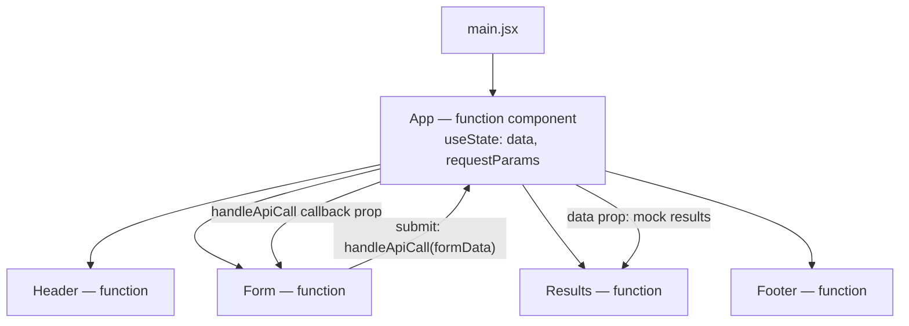

# rest-ez

A browser-based API testing application built with React and Vite.
Lab 26 establishes the component structure and displays mock response data.

## Setup

```bash
npm install
npm run dev
```

Open the local address printed by Vite.

## Phase 1

- Owns request parameters and response data in a class component; `src/App.jsx`.
- Renders Header, Footer, Form, and Results as function components; `src/Components/`.
- Submits fixed GET parameters through a callback prop; `Form`, `App.callApi`.
- Displays formatted mock JSON; `Results`.
- Loads application and component styles from SCSS files.

## Phase 2 Progress

- Converted `App` to a function component with request and response state; `src/App.jsx`.
- Added controlled URL, method, and POST/PUT body inputs with active-method styling; `Form`.
- Manually verified submitted values and separation between edited and submitted state.
- Pending: loading state, separate response headers/body, automated tests, and CI.

## Current Limitations

- Responses remain mocked; no network request is performed.
- Loading indicators and separate response headers/body are pending.
- Request history remains for a later phase.

## Verification

Manual browser verification: submitting with GO! displays GET, the fixed
Pokémon endpoint, and two mock results.

```bash
npm run lint
npm run build
```

ESLint and the production build passed; `npm run lint`, `npm run build`.

Automated tests, CI, and deployment are not configured.

## UML



## Pull Requests

- [Lab 26: Component refactor](https://github.com/tonch-LIV/rest-ez/pull/1)

## Changelog

- Established the course starter and installed lab dependencies; `src/`, `package.json`.
- Converted child components to functions and separated component styles while preserving mock submission; `src/Components/`, `src/App.scss`.
- Documented application behavior, setup, and current limitations; `README.md`, `src/App.jsx`.
- Added hook-based request state and controlled form inputs; `App`, `Form`.
