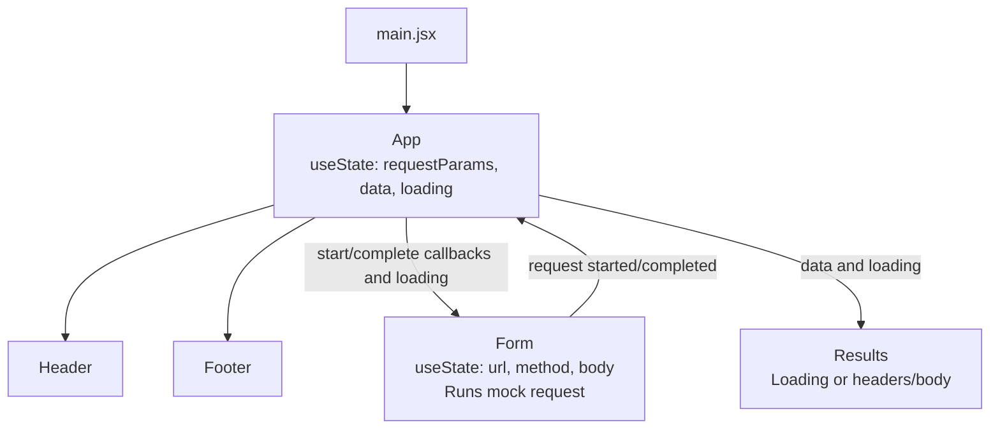

# rest-ez

A browser-based API testing application built with React and Vite.
Lab 26 establishes the component structure and displays mock response data.

## Setup

```bash
npx --yes npm@11.6.0 install
npm run dev
```

Uses npm 11.6.0 to avoid the peer-dependency resolver crash encountered with npm 10.8.2.

Open the local address printed by Vite.

## Phase 1 - Lab 26 baseline

- Owns request parameters and response data in a class component; `src/App.jsx`.
- Renders Header, Footer, Form, and Results as function components; `src/Components/`.
- Submits fixed GET parameters through a callback prop; `Form`, `App.callApi`.
- Displays formatted mock JSON; `Results`.
- Loads application and component styles from SCSS files.

## Phase 2 Progress

- Converted `App` to a function component with request and response state; `src/App.jsx`.
- Added controlled URL, method, and POST/PUT body inputs with active-method styling; `Form`.
- Manually verified submitted values and separation between edited and submitted state.
- Added request loading state and separate formatted response headers/body; `App`, `Form`, `Results`.
- Added behavior tests and a CI workflow; `src/App.test.jsx`, `.github/workflows/ci.yml`.
- First GitHub Actions ran and passed.

## Current Limitations

- Responses remain mocked; no network request is performed.
- Request history remains for a later phase.

## Verification

Manually verified entered request values, active-method selection, conditional POST/PUT body input, loading status, disabled controls during requests, and separately formatted response headers/body.

```bash
npm run lint
npm run test:run
npm run build
```

Local ESLint, all five behavior tests, and the production build passed; `npm run lint`, `npm run test:run`, `npm run build`.

GitHub Actions passed dependency installation, ESLint, all five tests, and the production build; `.github/workflows/ci.yml`.
Deployment is not configured.

## UML



## Pull Requests

- [Phase 1 | Lab 26: Component refactor](https://github.com/tonch-LIV/rest-ez/pull/1)
- [Phase 2 | Lab 27: useState implementation & refactor](https://github.com/tonch-LIV/rest-ez/pull/2)

## Changelog

- Established the course starter and installed lab dependencies; `src/`, `package.json`.
- Converted child components to functions and separated component styles while preserving mock submission; `src/Components/`, `src/App.scss`.
- Documented application behavior, setup, and current limitations; `README.md`, `src/App.jsx`.
- Added hook-based request state and controlled form inputs; `App`, `Form`.
- Added simulated request loading and separate response headers/body; `App`, `Form`, `Results`.
- Added request-flow tests and automated lint/test/build checks; `src/App.test.jsx`, `.github/workflows/ci.yml`.
- Selected npm 11.6.0 for dependency installation locally and in CI; `README.md`, `.github/workflows/ci.yml`.
